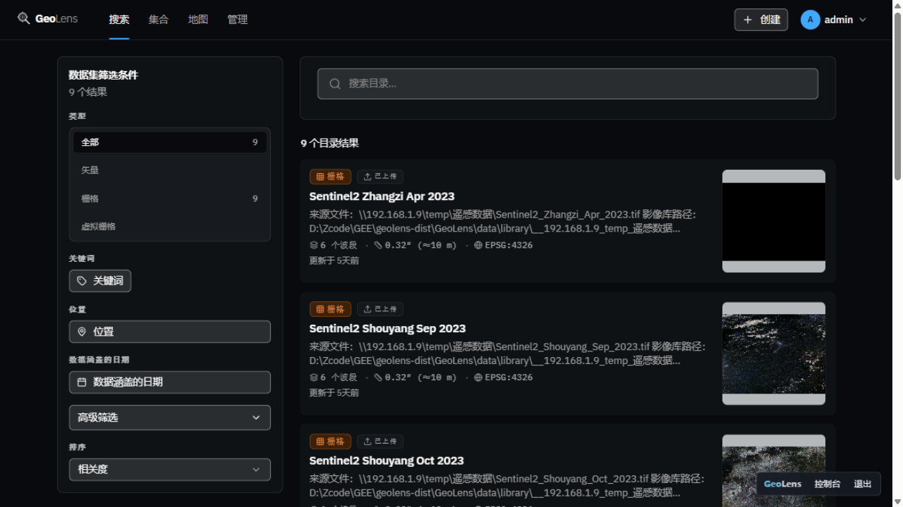
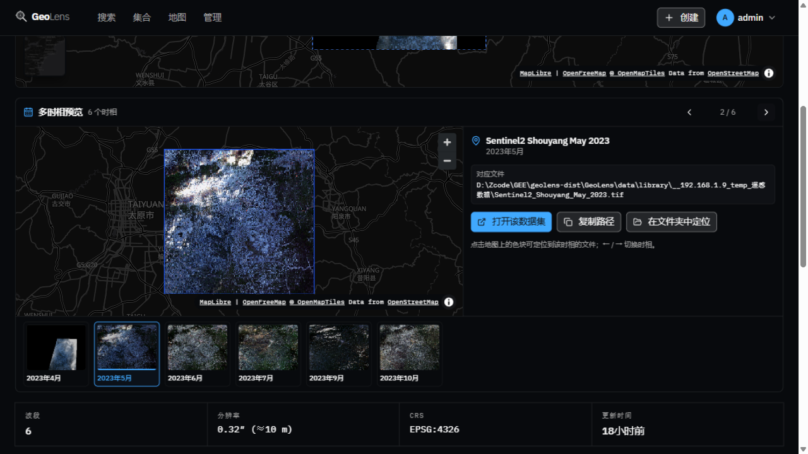
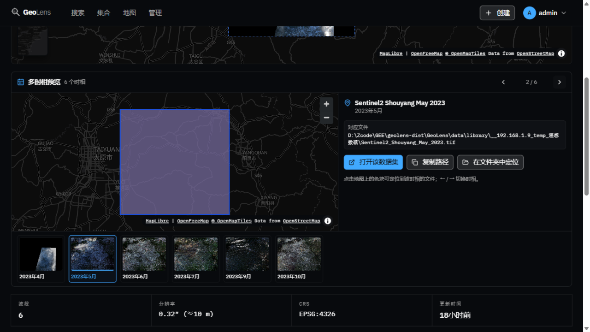
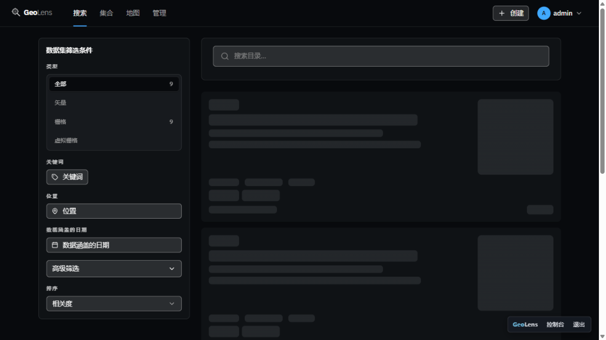

# GeoLens Windows 本地版（二次开发）

把开源的 [GeoLens](https://github.com/geolens-io/geolens) 空间数据目录改造成一个**开箱即用的 Windows 桌面产品**：双击一个 exe，自带 PostgreSQL / PostGIS / pgvector / Python / TiTiler，不需要 Docker、不需要登录，把遥感影像拖进一个文件夹就自动整理、入库、切片、出图。

> 本项目是基于 GeoLens 1.29.2 的二次开发，遵循 Apache-2.0 许可证。
> 上游版权归 geolens-io/geolens 所有；本仓库只包含 Windows 封装层、针对桌面场景的改动，以及修改后的上游源码快照。

---

## 界面

| 数据目录（免登录，自动管理员） | 多时相预览 |
|---|---|
|  |  |

| 点击地图定位到时相文件 | 启动进度页 |
|---|---|
|  |  |

## 功能

- **一个 exe、一个端口、一个窗口**：双击 `GeoLens.exe` → 进度页 → 数据目录（`http://127.0.0.1:8080`）。
- **无需登录**：本地部署自动进入管理员会话（可用 `server.auto_login=false` 恢复原登录）。
- **免安装依赖**：内置 PostgreSQL 16.15、PostGIS 3.6.2、pgvector 0.8.6、Python 3.13 + GDAL 3.13、TiTiler 2.4，不依赖 Docker。
- **单一拖放文件夹**：把影像拖进 `影像导入\`，每 15 秒扫描一次，自动复制到 `data\library` 并入库；按内容指纹去重。
- **多时相预览**：同一区域按月份自动归组，缩略图/方向键切换，点击地图色块列出该位置的时相并定位到文件；本机可"在文件夹中定位"。
- **16 位/浮点影像默认 2–98% 百分位拉伸**，不再整片发黑。
- **本地影像库整理**：复制 / 移动 / 硬链接；ENVI `.img`、JP2 等自动转 GeoTIFF；Shapefile 自动打包上传。
- **局域网访问**：控制台一键开启，只额外开放网页端口；控制台本身始终仅本机可访问。
- **前后端分离模式**：另提供命令行后端 + 独立网页（8081），便于把网页放到另一台机器。

## 下载

到 [Releases](https://github.com/mengzhuoer/geolens-windows/releases/latest) 下载：

| 文件 | 说明 |
|---|---|
| `GeoLens-Portable-<版本>-win64.zip` | 免安装版，解压后双击 `GeoLens.exe` |
| `GeoLens-Setup-<版本>-win64.exe` | 安装包（用户级安装到 `%LOCALAPPDATA%\GeoLens`，含快捷方式/卸载） |

系统要求：Windows 10/11 x64。首次启动约 20–35 秒初始化数据库，之后约 8–15 秒。

### 快速开始

1. 双击 `GeoLens.exe`，等待进度页走完，自动进入数据目录；
2. 把遥感影像拖进程序目录下的 `影像导入\`（支持 `.tif/.tiff`（含 BigTIFF）、`.img`、`.jp2`、`.shp`（连同 dbf/shx/prj）、`.gpkg`、`.geojson`、`.fgb`、`.kml/.kmz` 等）；
3. 约 15 秒后刷新/查看目录，即可预览、出图、切片；
4. 窗口右下角浮条：**控制台**（服务状态、影像库设置、局域网）、**退出**（连点两次停止全部服务）。

更多说明见 [docs/USAGE.md](docs/USAGE.md) 与 [docs/FAQ.md](docs/FAQ.md)。

## 与上游的差异

Windows 封装层（本仓库新增）

- `desktop/`：启动器、单端口反向代理、进程编排、控制台、影像库 librarian。
- 单端口同源：SPA + `/api` + `/raster-tiles` 收进 8080，无跨域问题。
- 启动进度页 `/__boot/` 与右下角浮条（`/__shell.js`，仅桌面代理注入）。
- 内置运行时组装、PyInstaller 打包、NSIS 安装脚本。

上游源码改动（均标注在 `docs/UPSTREAM-CHANGES.md`）

- BigTIFF 魔数校验、GDAL `gdaladdo` 兼容、OGR PostgreSQL 驱动路径、Windows 缺少 `resource` 模块。
- Worker 健康检查端口可配置；Selector 事件循环 + 子进程 shim（psycopg / ogrinfo）。
- 无登录模式：`POST /auth/auto-login`（仅 `GEOLENS_AUTO_LOGIN=1` 时启用）。
- `POST /datasets/{id}/reveal`：在资源管理器中定位影像文件（仅 Windows/本机）。
- 前端：`AUTO_LOGIN` 环境开关、多时相预览组件、详情页百分位拉伸、瓦片绝对基址。

## 技术架构

```text
GeoLens.exe（PyInstaller 启动器，单实例）
└── GeoLens.exe --service（detach 后台服务）
    ├── HTTP 前端 :8080   SPA + /api 反代 + /raster-tiles 反代 + /__boot + /__shell.js
    ├── PostgreSQL 16.15  :54329（仅 127.0.0.1）
    ├── FastAPI 后端       :8000（仅 127.0.0.1，Selector 事件循环）
    ├── TiTiler           :8002
    └── Procrastinate worker :8003（健康检查）
```

- 数据库、API、切片、Worker 全部只监听回环；唯一对局域网开放的是网页端口。
- 子进程带启动器 watchdog：后台服务退出时停止 PostgreSQL，不留孤儿进程。
- 详细设计见 [docs/ARCHITECTURE.md](docs/ARCHITECTURE.md)。

## 从源码构建

```powershell
git clone https://github.com/mengzhuoer/geolens-windows.git
cd geolens-windows

# 1) 准备 Python 3.13 + GDAL 运行时与 PostgreSQL / PostGIS / pgvector
powershell -ExecutionPolicy Bypass -File scripts/prepare-runtime.ps1

# 2) 构建前端、打包启动器并组装 dist/GeoLens
powershell -ExecutionPolicy Bypass -File scripts/build.ps1

# 3) 生成免安装 ZIP 与安装包（需要 NSIS）
powershell -ExecutionPolicy Bypass -File scripts/package-release.ps1
```

完整步骤、组件下载地址与常见坑见 [docs/BUILD.md](docs/BUILD.md)。

## 仓库结构

```text
app/backend/         上游 FastAPI 后端（含本项目改动）
app/frontend/        上游 React/Vite 前端（含本项目改动）
desktop/src/         Windows 封装层（启动器、代理、控制台、librarian）
desktop/installer/   NSIS 安装脚本
desktop/GeoLens.spec PyInstaller 打包配置
scripts/             运行时准备、构建、打包脚本
docs/                使用说明、构建、架构、FAQ、上游改动清单
```

## 支持与反馈

- 使用问题、构建问题：请开 [Issue](https://github.com/mengzhuoer/geolens-windows/issues)，并附上 `data\logs\` 下的 `desktop.log` / `api.log`（可先脱敏路径）。
- 安全问题：见 [SECURITY.md](SECURITY.md)，请勿公开提交敏感细节。
- 参与开发：见 [CONTRIBUTING.md](CONTRIBUTING.md)。
- 上游 GeoLens 的通用问题请到 [geolens-io/geolens](https://github.com/geolens-io/geolens/issues) 反馈。

> **安全提示**：本产品默认无登录，凡是能访问网页端口的人都有完整管理权限。请只在可信的本机/局域网使用，不要把端口映射到公网。

## 许可证与致谢

- 本项目遵循 [Apache License 2.0](LICENSE)，并保留上游 [NOTICE](NOTICE) 与商标声明 [TRADEMARKS.md](TRADEMARKS.md)。
- 上游项目：[geolens-io/geolens](https://github.com/geolens-io/geolens)（Apache-2.0）。
- 内置组件：PostgreSQL、PostGIS、pgvector、GDAL/PROJ、TiTiler、MapLibre GL 等，许可见 [THIRD_PARTY-LICENSES.md](THIRD_PARTY-LICENSES.md)。
- "GeoLens" 名称与标识归上游项目所有；本项目是非官方二次开发发行版。

## English

A Windows, out-of-the-box distribution of [GeoLens](https://github.com/geolens-io/geolens): one executable, no Docker, no login, a single watched drop folder for imagery, multi-temporal preview, and LAN access. It bundles PostgreSQL/PostGIS/pgvector, Python+GDAL and TiTiler. Built with Apache-2.0 upstream sources; see `docs/` for build and architecture notes. This is an unofficial fork and is not affiliated with the upstream maintainers.
